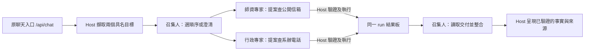

# 角色契約與 ADR：中央分工的唯讀查詢

原流程通常採單一分支。問「教師信箱＋系辦電話」時，教師聯絡資料與單位電話可分別查證；把整句交給任一分支容易漏一項或選錯單位。本週用召集人統一分派、驗收及整合兩份結果。

兩個專家任務在 v1 **依序**執行，控制權留在召集人，沒有切換 active role 或宣稱並行加速。

| 角色 | context | 權限 | 交付 |
| --- | --- | --- | --- |
| 召集人 | 派工時為擷取的兩個目標；整合時為兩份結果與版本 | 選派工順序、要求澄清、選呈現順序；無工具 | 受限 action，不能產生新的信箱、電話或來源 |
| 師資專家 | 教師全名、選填所屬 | 只允許 `lookup_faculty_email` | 狀態、公開信箱、citation |
| 行政專家 | 系所名稱或別名 | 只允許 `lookup_office_phone` | 狀態、公開電話或分機、citation |

每位專家都有獨立 Gemini 呼叫與唯讀 function declaration。Host 比對工具名和原任務參數，再執行本機查詢。最後一次召集人呼叫讀取工具結果，Host 以核可資料組裝最終回覆。事件、來源、chunk ID 與狀態皆可從軌跡核對。

分流支援「和」「跟」「與」等連接詞，但仍只接一筆具名教師信箱與一筆系辦電話。行政工具優先使用該系的全校名錄電話；資工系名錄未收錄時，改查既有的資工系辦官方快照，並引用實際提供電話與分機的來源，不借用其他系的電話。

- **協調：** 每次請求有獨立 run；ledger 記 task ID、唯一 owner、狀態、版本。result board 記 from／to、來源與同一版號；由 Host 維護，模型不能覆寫。未派工、失敗和正常交付分開記錄。
- **最小資料：** 只委派原問題中具名且可擷取的教師和系所。專家不接收完整聊天、私人記憶、草稿或其他專家的 context。此入口不讀帳號記憶；由個人記憶改寫的問題也不得觸發 MAS。
- **停止：** 正常至多 4 次模型步驟，請求逾時設定 8 秒、不重試。查不到或同名不同信箱不猜；仍可保留另一項查證成功的資料。兩項皆缺時不整合；整合失敗時由 Host 列出已驗證事實並明示失敗。對話 reset 或換資料版本後沿用舊 SessionHost 守門丟棄晚到結果。

**決策：** 保留為選用候選。這次驗證支持可整合兩份有來源的結果，但不能證明比程式直接查兩個資料來源更快、更準或更省。正式採用前應加上確定性的雙路查詢對照與真實量測。
